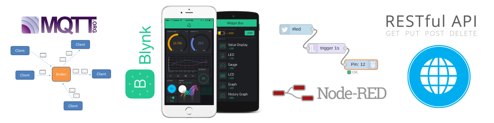

# TinyGSM

[](https://vshymanskyy.github.io/StandWithUkraine)

<!--! @if GITHUB -->


<!--! @endif -->

A small Arduino library for AT-command-based internet modules, that just works.

<!--! @image{inline} html logo.png TinyGSM logo -->
<!--! @image{inline} xml logo.png TinyGSM logo -->

<!--! @tableofcontents -->

<!--! @m_footernavigation -->

<!--! @if GITHUB -->

<!-- [](https://github.com/vshymanskyy/TinyGSM/releases/latest) -->
[](https://github.com/vshymanskyy/TinyGSM/releases/latest)
<!-- [](https://travis-ci.org/vshymanskyy/TinyGSM) -->
[](https://github.com/vshymanskyy/TinyGSM/issues)
[](https://github.com/vshymanskyy/TinyGSM/wiki)
[](https://github.com/vshymanskyy/TinyGSM/stargazers)
[](https://github.com/vshymanskyy/TinyGSM/blob/master/LICENSE)

If you like **TinyGSM** - give it a star, or fork it and contribute!
[](https://github.com/vshymanskyy/TinyGSM/stargazers)
[](https://github.com/vshymanskyy/TinyGSM/network)

You can also join our chat:
[](https://app.gitter.im/#/room/#tinygsm_Lobby:gitter.im)

- [TinyGSM](#tinygsm)
  - [Overview](#overview)
    - [Arduino Client interface support](#arduino-client-interface-support)
  - [Supported modems](#supported-modems)
  - [Features](#features)
  - [Credits](#credits)
  - [Getting Started](#getting-started)
    - [First Steps](#first-steps)
    - [Writing your own code](#writing-your-own-code)
    - [If you have any issues](#if-you-have-any-issues)
  - [How does it work?](#how-does-it-work)
  - [API Reference](#api-reference)
  - [Troubleshooting](#troubleshooting)
    - [Ensure stable data \& power connection](#ensure-stable-data--power-connection)
    - [Baud rates](#baud-rates)
    - [Broken initial configuration](#broken-initial-configuration)
    - [Failed connection or no data received](#failed-connection-or-no-data-received)
    - [Diagnostics sketch](#diagnostics-sketch)
    - [Web request formatting problems - "but it works with PostMan"](#web-request-formatting-problems---but-it-works-with-postman)
    - [SoftwareSerial problems](#softwareserial-problems)
    - [ESP32 Notes](#esp32-notes)
      - [HardwareSerial](#hardwareserial)
      - [HttpClient](#httpclient)
    - [SAMD21](#samd21)
    - [Goouuu Tech IOT-GA6 vs AI-Thinker A6 confusion](#goouuu-tech-iot-ga6-vs-ai-thinker-a6-confusion)
    - [SIM800 and SSL](#sim800-and-ssl)
    - [Which version of the SIM7000 code to use](#which-version-of-the-sim7000-code-to-use)
  - [License](#license)

<!--! @endif -->

## Overview

### Arduino Client interface support

This library is easy to integrate with lots of sketches which use Ethernet or WiFi.
**PubSubClient ([MQTT](http://mqtt.org/))**, **[Blynk](http://blynk.cc)**, **HTTP Client** and **File Download** examples are provided.

<!--! @if GITHUB -->



<!--! @endif -->

<!--! @image{inline} html examples.png -->
<!--! @image{inline} xml examples.png -->

<!--! @todo Update size specs for TinyGSM -->

## Supported modems

- SIMCom SIM800 series (SIM800A, SIM800C, SIM800L, SIM800H, SIM808, SIM868)
  - Previously tested by original author and current maintainer; updates not all tested
- SIMCom SIM900 series (SIM900A, SIM900D, SIM908, SIM968)
  - Previously tested by current maintainer; updates not all tested
- SIMCom WCDMA/HSPA/HSPA+ Modules (SIM5360, SIM5320, SIM5300E, SIM5300E/A)
  - Accepted as pull request and verified against manuals. Not personally tested by the maintainer.
- SIMCom LTE Modules (SIM7100E, SIM7500E, SIM7500A, SIM7600C, SIM7600E)
  - Accepted as pull request and verified against manuals. Not personally tested by the maintainer.
- SIMCom SIM7000E/A/G CAT-M1/NB-IoT Module
  - Previously tested by current maintainer; updates not all tested
- SIMCom SIM7070/SIM7080/SIM7090 CAT-M1/NB-IoT Module
  - Tested by the current maintainer; currently her primary cellular module
- SIMCom A7672x CAT-M1 Module
  - Accepted as pull request. Not personally tested by the maintainer.
- AI-Thinker A6, A6C, A7, A20
  - Previously tested by original author
- ESP8266/ESP32 (AT commands interface, similar to GSM modems)
  - Tested by the current maintainer; ESP32 is currently her primary WiFi module
- Digi XBee WiFi and Cellular (using XBee command mode)
  - Tested by the current maintainer, but *not recommended*
- Neoway M590
  - Previously tested by original author
- u-blox 2G, 3G, 4G, and LTE Cat1 Cellular Modems (many modules including LEON-G100, LISA-U2xx, SARA-G3xx, SARA-U2xx, TOBY-L2xx, LARA-R2xx, MPCI-L2xx)
  - Previously tested by the current maintainer (SARA-U201 only); updates not all tested
- u-blox LTE-M/NB-IoT Modems (SARA-R4xx, SARA-N4xx, SARA-R5xx, *but NOT SARA-N2xx*)
  - Tested by the current maintainer (SARA-R410M only)
- Sequans Monarch LTE Cat M1/NB1 (VZM20Q)
  - Previously tested by current maintainer; updates not all tested
- Quectel BG96
  - Tested by the current maintainer
- Quectel BG95
  - Accepted as pull request and verified against manuals. Not personally tested by the maintainer.
- Quectel M95
  - Accepted as pull request and verified against manuals. Not personally tested by the maintainer.
- Quectel MC60 ***(alpha)***
  - Accepted as pull request, though I have concerns about the implementation. Not personally tested by the maintainer.

Watch this repo for new updates!
And of course, contributions are welcome ;)

## Features

> [!TIP]
> [There is a full table with all functions available by module.](docs/SupportedModuleFunctions.md)

## Credits

- Primary Authors/Contributors:
  - [vshymanskyy](https://github.com/vshymanskyy)
  - [SRGDamia1](https://github.com/SRGDamia1/)
- SIM7000:
  - [captFuture](https://github.com/captFuture/)
  - [FStefanni](https://github.com/FStefanni/)
- Sequans Monarch:
  - [nootropicdesign](https://github.com/nootropicdesign/)
- Quectel MC60
  - [V1pr](https://github.com/V1pr)
- Quectel M95
  - [replicadeltd](https://github.com/replicadeltd)
- UBLOX SARA-R5
  - [Sebastian Bergner](https://github.com/sebastianbergner)
- SIMCOM A7672x
  - [Giovanni de Rosso Unruh](https://github.com/giovannirosso)
- Other Contributors:
  - <https://github.com/vshymanskyy/TinyGSM/graphs/contributors>

## Getting Started

### First Steps

  1. Using your phone:
    - Disable PIN code on the SIM card
    - Check your balance
    - Check that APN, User, Pass are correct and you have internet
  2. Ensure the SIM card is correctly inserted into the module
  3. Ensure that GSM antenna is firmly attached
  4. Ensure that you have a stable power supply to the module of at least **2A**.
  5. Check if serial connection is working (Hardware Serial is recommended)
     Send an `AT` command using [this sketch](extras/tools/AT_Debug/ReadMe.md)
  6. Try out the [WebClient](https://github.com/vshymanskyy/TinyGSM/blob/master/examples/WebClient/WebClient.ino) example

### Writing your own code

The general flow of your code should be:

- Define the module that you are using (choose one and only one)
  - ie, `#define TINY_GSM_MODEM_SIM800`
- Include TinyGSM
  - `#include <TinyGsmClient.h>`
- Create a TinyGSM modem instance
  - `TinyGsm modem(SerialAT);`
- Create one or more TinyGSM client instances
  - For a single connection, use
    - `TinyGsmClient client(modem);`
        or
        `TinyGsmClientSecure client(modem);` (on supported modules)
  - For multiple connections (on supported modules) use:
    - `TinyGsmClient clientX(modem, 0);`, `TinyGsmClient clientY(modem, 1);`, etc.
          or
    - `TinyGsmClientSecure clientX(modem, 0);`, `TinyGsmClientSecure clientY(modem, 1);`, etc.
  - Secure and insecure clients can usually be mixed when using multiple connections.
  - The total number of connections possible varies by module; check the [client configuration summary](docs/ClientConfigurationSummary.md) for your specific module.
- Begin your serial communication and set all your pins as required to power your module and bring it to full functionality.
  - The examples attempt to guess the module's baud rate.  In working code, you should use a set baud.
- Wait for the module to be ready (could be as much as 6s, depending on the module)
- Initialize the modem
  - `modem.init()` or `modem.restart()`
  - Restart generally takes longer than init but ensures the module doesn't have lingering connections
- Unlock your SIM, if necessary:
  - `modem.simUnlock(SIM_PIN)`
- If using a **WiFi** module, specify your SSID information:
  - `modem.networkConnect(wifiSSID, wifiPass)`
  - Network registration should be automatic on cellular modules
- Wait for network registration to be successful
  - `modem.waitForNetwork(600000L)`
  - New sim/tower combinations may take a *long* time to connect.
- If using cellular, establish the cellular data connection *after* you are successfully registered on the network
  - `modem.dataConnect(apn, simUser, simPass)` (or simply `modem.dataConnect(apn)`)
  - If using a **Digi** brand cellular XBee, you must specify your cellular data connection information *before* waiting for the network.  This is true ONLY for *Digi cellular XBees*!  *For all other cellular modules, use the cellular data connect function after network registration.*
- Connect the TCP or SSL client
    `client.connect(server, port)`
- Send out your data.

### If you have any issues

  1. Read the whole README (you're looking at it!), particularly the troubleshooting section below.
  2. Some boards require [**special configuration**](https://github.com/vshymanskyy/TinyGSM/wiki/Contributed-Pages/Board-configuration).
  3. Try running the Diagnostics sketch
  4. Check for [**highlighted topics here**](https://github.com/vshymanskyy/TinyGSM/issues?utf8=%E2%9C%93&q=is%3Aissue+label%3A%22for+reference%22+)
  5. If you have a question, please post it in our [Gitter chat](https://gitter.im/tinygsm)

## How does it work?

Many GSM modems, WiFi and radio modules can be controlled by sending AT commands over Serial.
TinyGSM knows which commands to send, and how to handle AT responses, and wraps that into standard Arduino Client interface.

This library is "blocking" in all of its communication.
Depending on the function, your code may be blocked for several *minutes* while waiting for the module responses.
Apart from the obvious (i.e., `waitForNetwork()`) several other functions may block your code for up to several *minutes*.
The `dataConnect()` and `client.connect()` functions commonly block the longest, especially in poorer service regions.
Shutting down or restarting the module may also be quite slow.

This library *does not* support any sort of "hardware" or pin-level controls for the modules.
If you need to turn your module on or reset it using some sort of High/Low/High pin sequence, you must write those functions yourself.
If you're interested in pin controls for your module, there's documentation of the wake/sleep protocols for most of the modules supported by this library in the [ModularSensors library](https://github.com/EnviroDIY/ModularSensors/).

## API Reference

For cellular data streams, this library provides the standard [Arduino Client](https://www.arduino.cc/en/Reference/ClientConstructor) interface.
For additional functions, please refer to [this example sketch](examples/AllFunctions/ReadMe.md)

## Troubleshooting

### Ensure stable data & power connection

Most modules require ***as much as 2A*** to properly connect to the network.
This is 4x what a "standard" USB will supply!
Improving the power supply actually solves stability problems in **many** cases!

- Read about [**powering your module**](https://github.com/vshymanskyy/TinyGSM/wiki/Contributed-Pages/Powering-GSM-module).
- Keep your wires as short as possible
- Consider soldering them for a stable connection
- Do not put your wires next to noisy signal sources (buck converters, antennas, oscillators etc.)
- If everything else seems to be working but you are unable to connect to the network, check your power supply!

### Baud rates

Most modules support some sort of "auto-bauding" feature where the module will attempt to adjust it's baud rate to match what it is receiving.
TinyGSM also implements its own auto bauding function (`TinyGsmAutoBaud(SerialAT, GSM_AUTOBAUD_MIN, GSM_AUTOBAUD_MAX);`).
While very useful when initially connecting to a module and doing tests, these should **NOT** be used in any sort of production code.
Once you've established communication with the module, set the baud rate using the `setBaud(#)` function and stick with that rate.

Some caveats with baud rates:

- `TINY_GSM_INTERCHAR_TIMEOUT_MS` sets the maximum silence allowed while waiting for the next character during short inter-character operations. `waitResponse()` also uses it to avoid splitting a response that is still arriving when its overall timeout expires. The default is 10 ms.
- `TINY_GSM_RESPONSE_MAX_GRACE_MS` limits how long `waitResponse()` can continue beyond its overall timeout while a response is still arriving. The default is 1000 ms.
- These timing defaults should work for most users. Override them before including TinyGSM only when a modem or stream transport is known to require different timing.
- If you are using a slow baud rate to communicate with your module, you may end up with data loss when buffers fill faster than they can be emptied.
- If you are using a very fast baud rate to communicate with your module, you may need to turn off AT debugging (using StreamDebugger or `DUMP_AT_COMMANDS`) to prevent data loss

### Broken initial configuration

Sometimes (especially if you played with AT commands), your module configuration may become invalid.
This may result in problems such as:

- Can't connect to the cellular data network
- Can't connect to the server
- Sent/received data contains invalid bytes
- etc.

To return module to **Factory Defaults**, use the [Factory Reset sketch](https://github.com/vshymanskyy/TinyGSM/tree/master/extras/tools/FactoryReset)

In some cases, you may need to set an initial APN to connect to the cellular network.
Try using the `dataConnect(APN)` function to set an initial APN if you are unable to register on the network.
You may need set the APN again after registering.
(In most cases, you should set the APN after registration.)

### Failed connection or no data received

The first connection with a new SIM card, a new module, or at a new location/tower may take a *LONG* time - up to 15 minutes or even more, especially if the signal quality isn't excellent.
If it is your first connection, you may need to adjust your wait times and possibly go to lunch while you're waiting.

If you are able to open a TCP connection but have the connection close before receiving data, try adding a keep-alive header to your request.
Some modules (ie, the SIM7000 in SSL mode) will immediately throw away any un-read data when the remote server closes the connection - sometimes without even giving a notification that data arrived in the first place.
When using MQTT, to keep a continuous connection you may need to reduce your keep-alive interval (PINGREQ/PINGRESP).

### Diagnostics sketch

Use the [diagnostics sketch](https://github.com/vshymanskyy/TinyGSM/tree/master/extras/tools/Diagnostics) to help diagnose SIM card and cellular data connection issues

If the diagnostics fail, uncomment this line to output some debugging comments from the library:

```cpp
#define TINY_GSM_DEBUG SerialMon
```

In any custom code, `TINY_GSM_DEBUG` must be defined before including the TinyGSM library.

If you are unable to see any obvious errors in the library debugging, use [StreamDebugger](https://github.com/vshymanskyy/StreamDebugger) to copy the entire AT command sequence to the main serial port.
In the diagnostics example, simply uncomment the line:

```cpp
#define DUMP_AT_COMMANDS
```

In custom code, you can add this snippet:

```cpp
#if defined(DUMP_AT_COMMANDS)
  #include <StreamDebugger.h>
  StreamDebugger debugger(SerialAT, SerialMon);
  TinyGsm modem(debugger);
#else
  TinyGsm modem(SerialAT);
#endif
```

### Web request formatting problems - "but it works with PostMan"

This library opens a TCP (or SSL) connection to a server.
In the [OSI model](https://en.wikipedia.org/wiki/OSI_model), that's [layer 4](http://www.tcpipguide.com/free/t_TransportLayerLayer4.htm) (or 5 for SSL).
HTTP (GET/POST), MQTT, and most of the other functions you probably want to use live up at [layer 7](http://www.tcpipguide.com/free/t_ApplicationLayerLayer7.htm).
This means that you need to either manually code the top layer or use another library (like [HTTPClient](https://github.com/arduino-libraries/ArduinoHttpClient) or [PubSubClient](https://pubsubclient.knolleary.net/)) to do it for you.
Tools like [PostMan](https://www.postman.com/) also show layer 7, not layer 4/5 like TinyGSM.
If you are successfully connecting to a server, but getting responses of "bad request" (or no response), the issue is probably your formatting.
Here are some tips for writing layer 7 (particularly HTTP request) manually:

- Look at the "WebClient" example
- Make sure you are including all required headers.
  - If you are testing with PostMan, make sure you un-hide and look at the "auto-generated" headers; you'll probably be surprised by how many of them there are.
- Use `client.print("...")` or `client.write(buf, #)` to help prevent text being sent out one character at a time (typewriter style).
- Enclose the entirety of each header or line within a single string or print statement

Use this:

```cpp
char buffer[128] = "";
int len = snprintf(buffer, sizeof(buffer), "GET %s HTTP/1.1\r\n", resource);
client.write((uint8_t*)buffer, len);
```

or this:

```cpp
client.print(String("GET ") + resource + " HTTP/1.1\r\n");
```

instead of this:

```cpp
client.print("GET ");
client.print(resource);
client.println(" HTTP/1.1");
```

- Make sure there is one entirely blank line between the last header and the content of any POST request.
  - Add two lines to the last header `client.print("....\r\n\r\n")` or put in an extra `client.println()`
  - This is an HTTP requirement and is really easy to miss.

### SoftwareSerial problems

When using `SoftwareSerial` (on Uno, Nano, etc), the speed **115200** may not work.
Try selecting **57600**, **38400**, or even lower - the one that works best for you.
In some cases **9600** is unstable, but using **38400** helps, etc.
Be sure to set correct TX/RX pins in the sketch.
Please note that not every Arduino pin can serve as TX or RX pin.
**Read more about AVR Serial options and configuration [on Paul Stoffregen's site](https://www.pjrc.com/teensy/td_libs_AltSoftSerial.html) and [the Arduino reference site](https://www.arduino.cc/en/Reference/SoftwareSerial).**

### ESP32 Notes

#### HardwareSerial

When using ESP32 `HardwareSerial`, you may need to specify additional parameters to the `.begin()` call.
Please [refer to this comment](https://github.com/vshymanskyy/TinyGSM/issues/91#issuecomment-356024747).

#### HttpClient

You will not be able to compile the HttpClient or HttpsClient examples with ESP32 core 1.0.2.
Upgrade to 1.0.3, downgrade to version 1.0.1 or use the WebClient example.

### SAMD21

When using SAMD21-based boards, you may need to use a SERCOM UART port instead of `Serial1`.
Please [refer to this comment](https://github.com/vshymanskyy/TinyGSM/issues/102#issuecomment-345548941).

### Goouuu Tech IOT-GA6 vs AI-Thinker A6 confusion

It turns out that **Goouuu Tech IOT-GA6** is not the same as **AI-Thinker A6**. Unfortunately IOT-GA6 is not supported out of the box yet. There are some hints that IOT-GA6 firmware may be updated to match A6... See [this topic](https://github.com/vshymanskyy/TinyGSM/issues/164).

### SIM800 and SSL

Some, but not all, versions of the SIM800 support SSL.
Having SSL support depends on the firmware version and the individual module.
Users have had varying levels of success in using SSL on the SIM800 even with apparently identical firmware.
If you need SSL and it does not appear to be working on your SIM800, try a different module or try using a secondary SSL library.

### Which version of the SIM7000 code to use

There are two versions of the SIM7000 code, one using `TINY_GSM_MODEM_SIM7000` and another with `TINY_GSM_MODEM_SIM7000SSL`.
The `TINY_GSM_MODEM_SIM7000` version *does not support SSL* but supports up to 8 simultaneous connections.
The `TINY_GSM_MODEM_SIM7000SSL` version supports both SSL *and unsecured connections* with up to 2 simultaneous connections.
So why are there two versions?
The "SSL" version uses the SIM7000's "application" commands while the other uses the "TCP-IP toolkit".
Depending on your region/firmware, one or the other may not work for you.
Try both and use whichever is more stable.
If you do not need SSL, I recommend starting with `TINY_GSM_MODEM_SIM7000`.

__________

## License

This project is released under
The GNU Lesser General Public License (LGPL-3.0)

<!--! @m_innerpage{page_supported_module_functions} -->
<!--! @m_innerpage{page_supported_module_configuration} -->
<!--! @m_innerpage{change_log} -->
<!--! @m_innerpage{todo} -->
<!--! @m_innerpage{deprecated} -->
